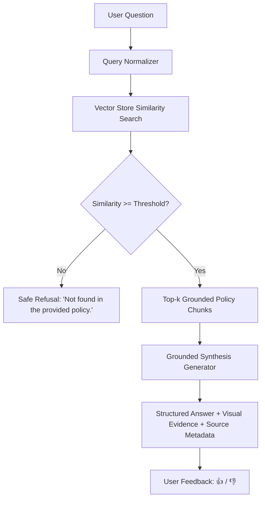

# PolicyLens AI — Grounded Insurance Policy Assistant

[](https://github.com)
[](https://fastapi.tiangolo.com/)
[](https://react.dev/)
[](https://tailwindcss.com/)

PolicyLens AI is a professional, production-grade **Insurance Policy Q&A Assistant** powered by Retrieval-Augmented Generation (RAG). It strictly answers coverage, exclusion, limit, deductible, and claim questions using provided fictional policy documents, featuring safe refusal when evidence is missing.
## 🚀 Live Demo

🌐 **Try PolicyLens AI:** [https://policy-lens-peach.vercel.app/](https://policy-lens-peach.vercel.app/)

[](https://policy-lens-peach.vercel.app/)


---

## 🏛️ Architecture & RAG Pipeline



### RAG Pipeline Features
- **Semantic Section & Clause Chunking**: Documents are chunked by section headers and clause numbers (`1.1`, `2.1`, `3.2`), preserving metadata (`policy_title`, `section_number`, `clause_number`, `clause_title`, `effective_date`).
- **Vector Retrieval Guardrails**: Features a similarity threshold check. If context is insufficient, the system safely declines with `"Not found in the provided policy."`
- **Visual Source Evidence**: Every response cites the exact policy title, section, clause, and short quoted evidence snippet.
- **Clause Comparison Matrix**: Side-by-side objective clause comparator for comparing limits, deductibles, and notification windows across policies.
- **25-Question Benchmark Suite**: Evaluates retrieval accuracy, grounding, attribution, and refusal across direct, paraphrased, multi-clause, ambiguous, and unanswerable questions.

---

## 🛠️ Technology Stack

- **Backend**: Python 3.10+, FastAPI, Uvicorn, SQLite, Scikit-Learn (TF-IDF Vector Engine / SentenceTransformers)
- **Frontend**: React 18, Vite, TypeScript, Tailwind CSS, Lucide Icons
- **Data**: 3 Fictional Policy Documents (`SecureDrive Motor`, `RoadGuard Motor`, `TravelShield Travel`) & 25-Question Benchmark Dataset

---

## 📂 Folder Structure

```
policy-lens/
├── backend/
│   ├── main.py              # FastAPI Server Entrypoint
│   ├── config.py            # Global Settings & Thresholds
│   ├── requirements.txt      # Python Dependencies
│   ├── database/
│   │   └── db.py            # SQLite Connection & Feedback Log
│   ├── ingestion/
│   │   ├── parser.py        # Section & Clause Regex Parser
│   │   └── chunker.py       # Metadata-preserving Chunker
│   ├── rag/
│   │   ├── vector_store.py  # Local Vector Database
│   │   ├── retriever.py     # Similarity Search & Threshold Guard
│   │   ├── generator.py     # Grounded Synthesis Engine
│   │   └── comparator.py    # Clause Comparison Engine
│   ├── api/
│   │   └── routes.py        # REST API Routes
│   └── tests/
│       └── test_rag.py      # Pytest Unit Test Suite
├── data/
│   ├── policies/
│   │   ├── secure_drive_motor.txt
│   │   ├── road_guard_motor.txt
│   │   └── travel_shield_travel.txt
│   └── evaluation_dataset.json
├── frontend/
│   ├── package.json
│   ├── vite.config.ts
│   ├── src/
│   │   ├── App.tsx
│   │   ├── components/
│   │   │   ├── Header.tsx
│   │   │   ├── StatsBanner.tsx
│   │   │   ├── ChatTab.tsx
│   │   │   ├── SourceCard.tsx
│   │   │   ├── PoliciesTab.tsx
│   │   │   ├── ClauseViewerModal.tsx
│   │   │   ├── CompareTab.tsx
│   │   │   ├── EvaluationTab.tsx
│   │   │   ├── FeedbackTab.tsx
│   │   │   ├── GlossaryTab.tsx
│   │   │   └── Disclaimer.tsx
│   │   └── api/
│   │       └── client.ts
├── .env.example
└── README.md
```

---

## 🚀 How to Run

### 1. Backend Setup (FastAPI)
```bash
# Create virtual environment & install dependencies
python -m venv venv
venv\Scripts\activate
pip install -r backend/requirements.txt

# Start Backend Server (runs on http://127.0.0.1:8000)
python -m backend.main
```

### 2. Frontend Setup (React + Vite)
```bash
# Navigate to frontend directory
cd frontend

# Install Node dependencies
npm install

# Start Frontend Dev Server (runs on http://localhost:3000)
npm run dev
```

---

## 🧪 Running Unit Tests & Benchmark Suite

```bash
# Run pytest test suite for backend
pytest backend/tests/test_rag.py -v
```

In the Web UI:
- Open the **Evaluation** tab.
- Click **Run Evaluation Suite** to execute all 25 benchmark questions and calculate live grounded accuracy, refusal accuracy, and source attribution stats.

---

## ⚖️ Legal Disclaimer

> **Important Disclaimer:** This assistant provides information strictly from the supplied fictional policy documents only. It does not make official coverage decisions, provide legal advice, or provide personalized insurance recommendations.
